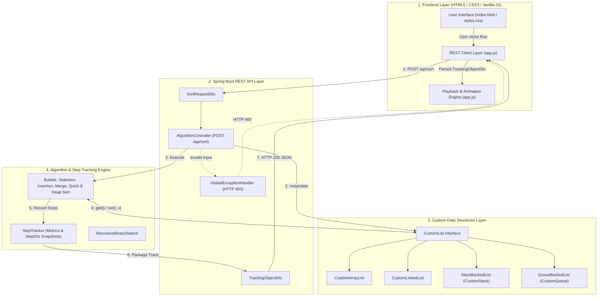

**Algorithm Explorer**

Algorithm Explorer is a full-stack interactive sorting and searching visualization platform built from scratch without using standard `java.util` collection classes for algorithm execution. It pairs a Spring Boot REST backend with a Vanilla JavaScript animation engine to execute, benchmark, and visualize six sorting algorithms and recursive binary search across four custom-built data structures.

---

## Team Members

| Name | 
| :--- |
| Tendo Kavuma Arthur C.
| Keith Rowland |
| Joshua Odaga |
| Manzi Joel |
| Conrad Mugisha |

---

## Languages, Frameworks, and Tools

### Programming Languages
* **Java 17:** Core language used to implement custom data structures, sorting and searching algorithms, step-tracking instrumentation, and the REST API layer.
* **JavaScript (ES6+):** Powers the client-side state management, asynchronous Fetch API calls, deterministic playback loop, bar renderer, and recursion tree visualizer.
* **HTML5:** Structures the interactive control panels, metrics dashboard, playback controls, and visualization canvases.
* **CSS3:** Provides responsive layout styling, custom theme variables, bar transition states, and pointer badge animations.

### Frameworks and Libraries
* **Spring Boot 3.2.5 (`spring-boot-starter-web`):** Hosts the embedded Apache Tomcat server, serves static frontend assets, exposes the RESTful endpoints (`/api/sort` and `/api/health`), and manages JSON serialization via Jackson.
* **JUnit 5 (`spring-boot-starter-test`):** Executes automated unit and integration tests across all custom data structures, algorithms, and HTTP error-handling paths.

### Build and Version Control Tools
* **Apache Maven (Maven Wrapper `mvnw`):** Manages project dependencies, compilation, test execution, and application packaging without requiring a manual global Maven installation.
* **Git & GitHub:** Used for branch-based version control, peer code reviews, and Pull Request workflows.

---

## How the System Works

Algorithm Explorer separates algorithm execution and performance measurement on the backend from visual playback on the frontend.

### 1. End-to-End Execution Workflow

1. **User Input and Configuration:** The user enters a custom integer array (or generates a random preset), selects one of the six sorting algorithms, and chooses one of the four underlying custom data structures in the browser UI.
2. **REST API Request:** The frontend (`app.js`) sends an asynchronous `POST /api/sort` request containing a JSON payload (`SortRequestDto`) with the input array, chosen algorithm key, and chosen data structure key.
3. **Validation and Error Handling:** `AlgorithmController` validates the request parameters. If the array is empty, exceeds the maximum permitted length, or contains an unrecognized algorithm or structure name, `GlobalExceptionHandler` intercepts the error and returns a structured `HTTP 400 Bad Request` JSON response.
4. **Custom Data Structure Instantiation:** The backend loads the input numbers into the selected custom implementation (`CustomArrayList`, `CustomLinkedList`, `StackBackedList`, or `QueueBackedList`) behind the unified `CustomList<Integer>` interface.
5. **Instrumented Sorting and Step Recording:** The selected sorting algorithm mutates the `CustomList<Integer>` in place. Every comparison, swap, value overwrite, pointer movement, recursion stack change, and merge tree snapshot is recorded into a `StepTracker` instance.
6. **Nanosecond Timing and Verification:** The backend measures total execution duration using `System.nanoTime()`, verifies the sorted sequence using `RecursiveBinarySearch` with call-trace logging stored in a `CustomQueue<String>`, and packages the results into a `TrackingObjectDto`.
7. **Deterministic Visual Playback:** The browser receives the complete `StepDto[]` trace and renders bar charts, active index pointers (`i`, `j`, `minIdx`, `keyIdx`, `pivot`, `left`, `right`), recursion call frames, and real-time operation counters. Users can play, pause, adjust playback speed, or step forward and backward frame by frame.

### 2. System Architecture Diagram



### 3. Implemented Custom Data Structures

All data structures reside in `com.group13.algorithmexplorer.datastructures` and implement or support `CustomList<T>` without relying on `java.util.ArrayList`, `java.util.LinkedList`, `java.util.Stack`, or `java.util.Queue`:

* **CustomArrayList (`arraylist`):** Dynamically resizing contiguous array that doubles capacity when full, providing $O(1)$ indexed reads and writes.
* **CustomLinkedList (`linkedlist`):** Doubly linked node chain (`Node<T>`) supporting bidirectional traversal for indexed access and element mutation.
* **CustomStack and StackBackedList (`stack`):** Pure LIFO linked stack (`push`, `pop`, `peek`) paired with a `CustomList<T>` adapter that uses an auxiliary `CustomStack<T>` to access and update target indices.
* **CustomQueue and QueueBackedList (`queue`):** Pure FIFO linked queue (`enqueue`, `dequeue`, `peek`) paired with a `CustomList<T>` adapter that rotates elements through the queue to perform indexed reads and writes.

### 4. Implemented Algorithms

All algorithms reside in `com.group13.algorithmexplorer.algorithms`:

| Algorithm | Key | Best Time | Average Time | Worst Time | Space |
| :--- | :--- | :--- | :--- | :--- | :--- |
| Bubble Sort | `bubble` | $O(n)$ | $O(n^2)$ | $O(n^2)$ | $O(1)$ |
| Selection Sort | `selection` | $O(n^2)$ | $O(n^2)$ | $O(n^2)$ | $O(1)$ |
| Insertion Sort | `insertion` | $O(n)$ | $O(n^2)$ | $O(n^2)$ | $O(1)$ |
| Merge Sort | `merge` | $O(n \log n)$ | $O(n \log n)$ | $O(n \log n)$ | $O(n)$ |
| Quick Sort | `quick` | $O(n \log n)$ | $O(n \log n)$ | $O(n^2)$ | $O(\log n)$ |
| Heap Sort | `heap` | $O(n \log n)$ | $O(n \log n)$ | $O(n \log n)$ | $O(1)$ |
| Recursive Binary Search | N/A | $O(1)$ | $O(\log n)$ | $O(\log n)$ | $O(\log n)$ |

---

## How to Run the Application

### Prerequisites

* **Java Development Kit (JDK):** Version 17 or higher installed and added to your system `PATH`.
* **Maven:** Included automatically via the project's Maven Wrapper (`mvnw` / `mvnw.cmd`). No separate Maven installation is required.
* **Web Browser:** Any modern browser (Chrome, Edge, Firefox, or Safari).

### Step 1: Clone the Repository

```bash
git clone https://github.com/ArthurKavuma/GROUP_13_ALGORITHM_EXPLORER.git
cd GROUP_13_ALGORITHM_EXPLORER
```

### Step 2: Start the Spring Boot Server

On **Windows (PowerShell or Command Prompt)**:

```powershell
.\mvnw.cmd spring-boot:run
```

On **macOS / Linux**:

```bash
./mvnw spring-boot:run
```

### Step 3: Open the Visualizer in Your Browser

Once the terminal displays `Started AlgorithmExplorerApplication`, open your browser and navigate to:

```text
http://localhost:8080
```

To verify the backend health endpoint directly, visit:

```text
http://localhost:8080/api/health
```

### Step 4: Run the Automated JUnit 5 Test Suite

The project includes unit and integration tests covering all four custom data structures, `RecursiveBinarySearch`, the full $6 \times 4$ algorithm-by-data-structure execution matrix, and `HTTP 400` validation edge cases.

On **Windows**:

```powershell
.\mvnw.cmd test
```

On **macOS / Linux**:

```bash
./mvnw test
```

---

## Project Directory Structure

```text
GROUP_13_ALGORITHM_EXPLORER/
|-- pom.xml
|-- mvnw.cmd
|-- .gitignore
|-- src/
    |-- main/
    |   |-- java/com/group13/algorithmexplorer/
    |   |   |-- AlgorithmExplorerApplication.java
    |   |   |-- algorithms/
    |   |   |   |-- BubbleSort.java
    |   |   |   |-- SelectionSort.java
    |   |   |   |-- InsertionSort.java
    |   |   |   |-- MergeSort.java
    |   |   |   |-- QuickSort.java
    |   |   |   |-- HeapSort.java
    |   |   |   |-- RecursiveBinarySearch.java
    |   |   |   `-- StepTracker.java
    |   |   |-- controller/
    |   |   |   |-- AlgorithmController.java
    |   |   |   `-- GlobalExceptionHandler.java
    |   |   |-- datastructures/
    |   |   |   |-- CustomList.java
    |   |   |   |-- CustomArrayList.java
    |   |   |   |-- CustomLinkedList.java
    |   |   |   |-- CustomStack.java
    |   |   |   |-- StackBackedList.java
    |   |   |   |-- CustomQueue.java
    |   |   |   |-- QueueBackedList.java
    |   |   |   `-- Node.java
    |   |   `-- dto/
    |   |       |-- SortRequestDto.java
    |   |       |-- TrackingObjectDto.java
    |   |       |-- StepDto.java
    |   |       |-- MetricsDto.java
    |   |       `-- PointerDto.java
    |   `-- resources/
    |       |-- application.properties
    |       `-- static/
    |           |-- index.html
    |           |-- styles.css
    |           `-- app.js
    `-- test/
        `-- java/com/group13/algorithmexplorer/
            `-- AlgorithmExplorerTests.java
```

